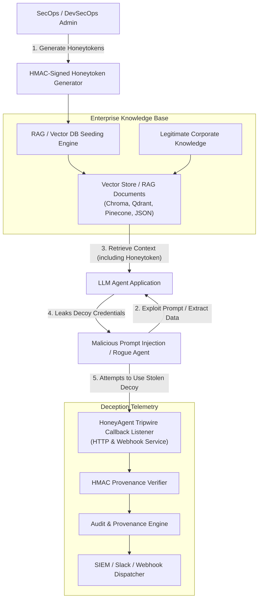

# HoneyAgent System Architecture

## 1. Executive Summary

**HoneyAgent** is an autonomous Deception Technology & Honeytoken infrastructure engineered specifically for Large Language Model (LLM) agents, Retrieval-Augmented Generation (RAG) pipelines, and Vector Knowledge Bases.

By strategically seeding realistic, digitally watermarked decoy credentials and canary chunks into vector stores and prompt contexts, HoneyAgent detects unauthorized data exfiltration, insider threats, and prompt injection attacks the exact moment an attacker attempts to utilize the stolen credentials.

---

## 2. End-to-End System Architecture

---

## 3. Honeytoken Cryptographic Architecture

Each generated honeytoken incorporates an embedded HMAC-SHA256 signature calculated over the token metadata:
* **Token Identifier**: `ht_<category>_<payload_id>_<hmac_sig>`
* **Payload Kinds**:
  1. `AWS_ACCESS_KEY`: Realistic format (`AKIA[0-9A-Z]{16}`) bound to a callback handler.
  2. `DATABASE_DSN`: Decoy PostgreSQL/MySQL connection string pointing to HoneyAgent port.
  3. `BEARER_API_TOKEN`: Synthetic JWT or bearer secret.
  4. `CANARY_DOCUMENT`: Decoy document containing a unique URL beacon.
* **Benefits**: The callback tripwire can instantly verify whether an incoming probe is a genuine honeytoken without locking an external database.

---

## 4. Component Architecture & Responsibilities

| Component | Module | Responsibility |
| :--- | :--- | :--- |
| **Generator** | `honeyagent.core.generator` | Generates HMAC-signed realistic credentials and canary documents. |
| **Registry** | `honeyagent.core.registry` | Manages deployed honeytokens, provenance tags, and deployment targets. |
| **Tripwire Server** | `honeyagent.server.listener` | Lightweight ASGI HTTP service intercepting probes, credential tests, and beacons. |
| **RAG Injector** | `honeyagent.engine.seeder` | Injects synthetic honey chunks into document collections and vector indices. |
| **Alert Dispatcher** | `honeyagent.engine.alerts` | Dispatches real-time intrusion alarms with IP, user-agent, and origin document tracing. |
