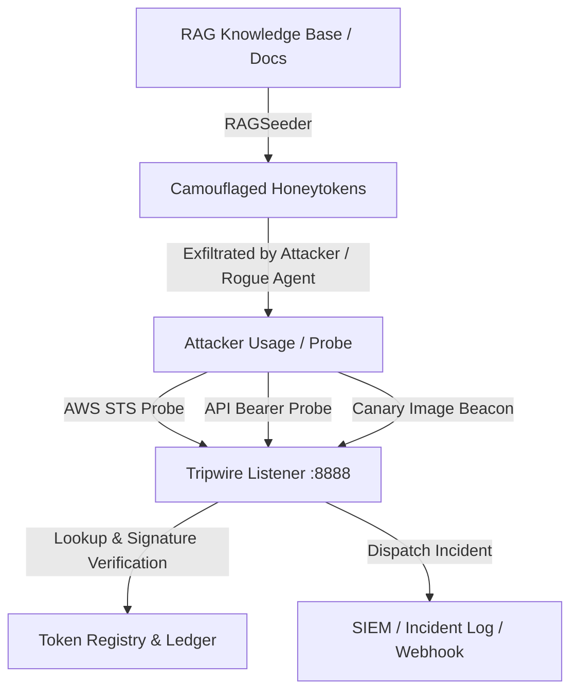

# HoneyAgent 🍯

> **Status:** prototype. A personal security-research project, not a production product. Expect rough edges; issues and pull requests are welcome.

> **Autonomous Honeytoken & Decoy Injection Orchestrator for LLM Agents & RAG Pipelines**

HoneyAgent is a prototype deception technology platform designed specifically for modern LLM applications, autonomous agent workflows, and Retrieval-Augmented Generation (RAG) vector pipelines.

It plants realistic, HMAC-signed honeytokens (cloud credentials, bearer tokens, database DSNs, and canary document beacons) inside document corpora, knowledge bases, and agent tool spaces. When an adversary or rogue agent accesses, exfiltrates, or invokes these decoy credentials, HoneyAgent triggers immediate SIEM intrusion alerts with cryptographic provenance attribution.

---

## 🌟 Key Features

- **Decoy Credential Synthesizer**: Generates structurally valid AWS Access Keys (`AKIA...`), database connection strings, API Bearer tokens, and transparent image canary beacons.
- **Cryptographic Provenance**: Every token embeds an HMAC signature binding the decoy to its specific injection source (e.g. `rag:q3_financial_report` or `agent:customer_support_vector`).
- **Autonomous Context Camouflage Seeder**: Automatically injects decoy credentials into Markdown documentation, READMEs, and JSON knowledge bases without breaking document syntax or readability.
- **Multi-Vector Tripwire Listener**: Lightweight FastAPI server that traps image canary beacon callbacks, unauthorized API bearer authentication probes, and simulated AWS STS `GetCallerIdentity` requests.
- **Intrusion Dispatcher & Ledger**: Emits real-time terminal alarms, persists structured JSONL incident telemetry (`token_id`, `provenance_tag`, `attacker_ip`, `user_agent`), and dispatches SIEM/Slack webhooks.

---

## 📐 Architecture



---

## 🚀 Quick Start

### 1. Installation

```bash
git clone https://github.com/csenta/honeyagent.git
cd honeyagent
pip install -r requirements.txt
```

### 2. Generate a Honeytoken

```bash
python3 -m honeyagent.cli generate --type AWS_ACCESS_KEY --provenance "rag:executive_salaries"
```

Output:
```text
🍯 [HoneyAgent] Generated Honeytoken
============================================================
  Token ID:       ht_aws_access_key_1d54bfd1_4602477adc25
  Token Type:     AWS_ACCESS_KEY
  Provenance:     rag:executive_salaries
  Value:          AKIAB03C8384120F2947
  Callback URL:   http://localhost:8888/beacon/ht_aws_access_key_1d54bfd1_4602477adc25
============================================================
```

### 3. Seed into Knowledge Base

```bash
python3 -m honeyagent.cli seed \
  --target /path/to/docs/cloud_architecture.md \
  --type AWS_ACCESS_KEY \
  --provenance "rag:cloud_arch"
```

### 4. Start the Tripwire Listener

```bash
python3 -m honeyagent.cli listen --host 0.0.0.0 --port 8888
```

### 5. Simulate an Intrusion Probe

```bash
python3 -m honeyagent.cli test-probe
```

---

## 🛠️ Testing

HoneyAgent includes a test suite covering token signing, registry persistence, markdown/JSON seeding, and tripwire interception:

```bash
PYTHONPATH=. python3 -m unittest discover -s tests -v
```

---

## 🐳 Docker Deployment

Run with Docker Compose:

```bash
docker-compose up --build -d
```

Or standalone:

```bash
docker build -t honeyagent .
docker run -p 8888:8888 -e HONEYAGENT_SECRET="prod_secret" honeyagent
```

## License

MIT. See [LICENSE](LICENSE).
